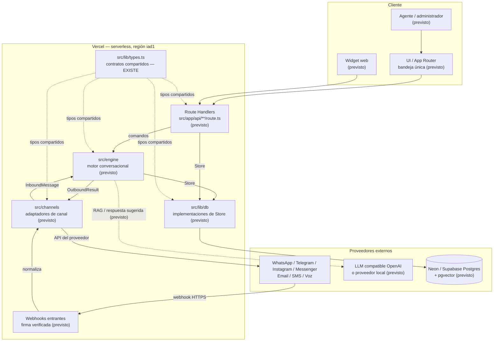
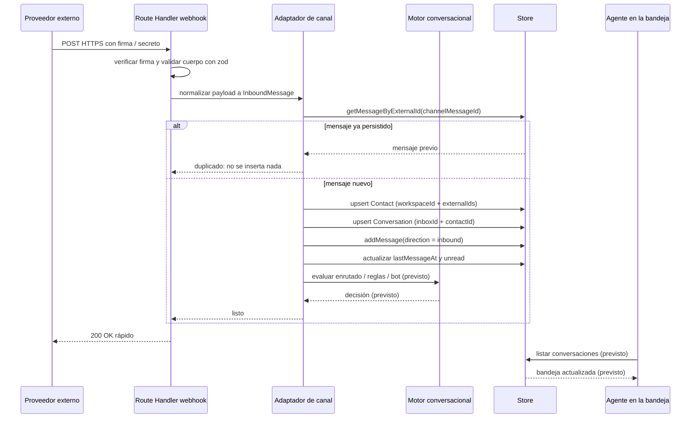

# Arquitectura de Conversa CRM

> Documento de diseño de la entrega 0 (esqueleto). Se distingue explícitamente entre
> lo que **existe hoy** en el repositorio y lo que está **previsto**.
> Diseño independiente inspirado en categoría de producto.

## 1. Principios rectores

1. **Un solo inbox**: una única bandeja de trabajo consolida todas las conversaciones,
   sin importar el canal de origen. El modelo de datos permite varias filas `Inbox`
   (una por canal y configuración de credenciales), pero la experiencia de usuario
   es una cola única de conversaciones.
2. **Multicanal por contrato, no por acoplamiento**: todos los proveedores producen
   el mismo evento `InboundMessage` y consumen el mismo resultado `OutboundResult`.
3. **Serverless-first**: se despliega en Vercel sin procesos persistentes, sin
   *listeners* de larga duración y sin estado en memoria entre peticiones.
4. **Monolito modular**: una sola aplicación Next.js con módulos separados por
   responsabilidad; no hay microservicios en esta fase.
5. **Contratos antes que implementaciones**: las interfaces compartidas ya viven en
   `src/lib/types.ts`, de modo que UI, API, canales, motor y datos hablan el mismo
   lenguaje.

## 2. Estado real de esta entrega

| Elemento | Estado | Evidencia |
| --- | --- | --- |
| Next.js 15 App Router + React 19 + TypeScript estricto | **Existe** | `package.json`, `tsconfig.json` |
| Alias `@/*` → `./src/*` | **Existe** | `tsconfig.json` |
| Configuración Vercel (región `iad1`, `maxDuration: 15`, `cleanUrls`) | **Existe** | `vercel.json` |
| Límite de cuerpo de Server Actions a 5 MB | **Existe** | `next.config.ts` |
| Contratos de dominio (9 entidades + eventos + `Store`) | **Existe** | `src/lib/types.ts` |
| Plantilla de variables de entorno | **Existe** | `.env.example` |
| Páginas y componentes (`src/app`, `src/components`) | **Previsto** | — |
| Route Handlers / webhooks (`src/app/api/**/route.ts`) | **Previsto** | `vercel.json` ya reserva su configuración |
| Adaptadores de canal (`src/channels`) | **Previsto** | contratos `ChannelDefinition`, `InboundMessage`, `OutboundResult` ya definidos |
| Motor conversacional (`src/engine`) | **Previsto** | — |
| Capa de datos (`src/lib/db`) | **Previsto** | interfaz `Store` ya definida |
| Esquema SQL y migraciones | **Previsto** | — |

> No se debe asumir que los directorios `src/channels`, `src/engine`, `src/lib/db`
> o `src/app` contienen código hoy: solo están anticipados por los contratos y la
> configuración indicados arriba.

## 3. Stack y configuración existente

| Pieza | Versión / valor | Uso |
| --- | --- | --- |
| `next` | `^15.5.0` | App Router, Route Handlers, Server Actions |
| `react` / `react-dom` | `^19.0.0` | Interfaz |
| `typescript` | `^5.7.2` | `strict: true`, `moduleResolution: bundler` |
| `pg` | `^8.13.1` | Cliente Postgres (producción, con `DATABASE_URL`) |
| `zod` | `^3.24.1` | Validación de payloads de webhooks y formularios (previsto) |
| `clsx` | `^2.1.1` | Composición de clases CSS (previsto) |
| `lucide-react` | `^0.468.0` | Iconografía (previsto) |
| Node.js | `>=20.9.0` | Requisito declarado en `engines` |

Scripts disponibles: `npm run dev`, `npm run build`, `npm run start`,
`npm run typecheck`.

`next.config.ts` activa `reactStrictMode`, desactiva `poweredByHeader` y fija
`experimental.serverActions.bodySizeLimit = "5mb"`.
`vercel.json` fija el framework `nextjs`, el directorio de salida `.next`, la
región `iad1`, URLs limpias y un `maxDuration` de **15 segundos** para todas las
rutas bajo `src/app/api/**/route.ts`.

## 4. Diagrama de componentes



## 5. Estructura prevista de directorios

```
src/
  app/                 # App Router: páginas y Route Handlers (previsto)
    api/**/route.ts    # webhooks entrantes y API saliente (previsto)
  channels/            # adaptadores por ChannelType (previsto)
  components/          # componentes de UI (previsto)
  engine/              # motor conversacional: reglas, bot, RAG (previsto)
  lib/
    types.ts           # contratos compartidos (EXISTE)
    db/                # Store local JSON y Store Postgres (previsto)
```

No hay frontend ni rutas API todavía: la entrega actual se limita a la base
técnica y a los contratos.

## 6. Capas y puntos de extensión

### 6.1 Capa de presentación (previsto)

App Router con React 19. La bandeja única mostrará `Conversation` ordenadas por
`lastMessageAt`, con filtros por `status`, `assigneeId`, `priority` y `labels`.
Las mutaciones se harán mediante Server Actions con validación `zod`.

### 6.2 Capa API y webhooks (previsto)

Cada canal entrante expondrá un `route.ts` que verifica la firma del proveedor,
valida el cuerpo con `zod`, delega la normalización al adaptador correspondiente
y responde **rápido** con `200`/`204`. El límite de 15 s de `vercel.json` obliga a
que el trabajo pesado (IA, indexación, envíos masivos) se encole o se ejecute en
un Cron de Vercel (previsto) en lugar de bloquear la respuesta.

### 6.3 Puntos de extensión de canales — `src/channels` (previsto)

El contrato ya existe en `src/lib/types.ts`:

- `ChannelType`: `widget`, `whatsapp`, `telegram`, `instagram`, `messenger`,
  `email`, `sms`, `voice`, `api`.
- `ChannelDefinition`: `type`, `name`, `description`, `docsUrl?`, `fields`
  (`CredentialField[]`), `inbound` y `outbound`. Un adaptador se registra
  declarando qué credenciales necesita y en qué direcciones opera.
- `InboundMessage`: evento normalizado — `channel`, `inboxId?`,
  `externalMessageId`, `externalContactId`, datos opcionales de contacto,
  `body`, `attachments`, `timestamp`, `subject` y `raw`.
- `OutboundResult`: `externalMessageId?`, `delivered`, `error?`.

Añadir un canal consistirá en crear un adaptador que implemente
`normalize(payload) → InboundMessage` y `send(message) → OutboundResult`, y
registrar su `ChannelDefinition`. Ni la bandeja ni el motor deberán cambiar.

### 6.4 Motor conversacional — `src/engine` (previsto)

Responsabilidades previstas: decorar el mensaje entrante, aplicar reglas de
enrutado (asignación, prioridad, etiquetas), decidir si corresponde una respuesta
automática y, cuando `BOT_AUTO_REPLY=true`, generar una sugerencia con un LLM
compatible OpenAI (`OPENAI_API_KEY`, `OPENAI_BASE_URL`, `OPENAI_MODEL`) sujeta a
`BOT_CONFIDENCE_THRESHOLD`. La recuperación de `KnowledgeArticle` con `embedding`
(con pgvector) es la fase RAG prevista. El motor nunca escribe directamente en el
proveedor: devuelve una intención que el adaptador de canal ejecuta.

### 6.5 Capa de datos — `src/lib/db` (previsto)

La interfaz `Store` ya define la superficie completa: `Workspace`, `User`,
`Conversation`, `Message`, `Contact`, `Inbox`, `KnowledgeArticle`, `Deal` y
`Task`, con operaciones `list*`, `get*`, `upsert*` y `addMessage`. Dos
implementaciones previstas:

- **Local JSON** (`.data/`): desarrollo sin servicios externos; se activa cuando
  `DATABASE_URL` está vacía según `.env.example`.
- **Postgres** (`pg` + `DATABASE_URL`): producción en Neon/Supabase.

El resto de la aplicación depende solo de `Store`, nunca del motor de base de
datos concreto. Véase `DATA_MODEL.md`.

### 6.6 Credenciales

Las credenciales se pueden inyectar por variables de entorno (`.env.example`) o
guardar en `Inbox.credentials` desde la UI; en ese caso se cifran en reposo con
`CREDENTIALS_ENCRYPTION_KEY`. El desencriptado ocurre únicamente en servidor, en
el momento de construir el cliente del adaptador. Véase `DATA_MODEL.md`.

## 7. Flujo de un mensaje entrante



Propiedades del flujo:

- La **idempotencia** se resuelve antes de cualquier escritura, usando
  `channelMessageId` (origen: `InboundMessage.externalMessageId`).
- La respuesta HTTP se envía antes de cualquier tarea larga.
- Toda escritura queda detrás de `Store`, de modo que el mismo flujo funciona con
  JSON local en desarrollo y con Postgres en producción.

## 8. Flujo saliente (previsto)

El agente envía desde la bandeja → Server Action → `Store.addMessage` con
`direction = "outbound"` y `senderType = "agent"|"bot"` → el motor resuelve el
adaptador según `Conversation.channel` → el adaptador llama a la API del
proveedor → `OutboundResult.externalMessageId` se persiste como
`channelMessageId` del mensaje saliente para poder correlacionar reintentos y
estados de entrega.

## 9. Por qué es compatible con Vercel

| Restricción de Vercel | Adaptación de Conversa CRM |
| --- | --- |
| Funciones efímeras, sin memoria persistente | Todo el estado vive en `Store` (JSON local en dev, Postgres en prod); nada se guarda en variables globales. |
| Sin *listeners* persistentes ni sockets de larga duración | Ningún canal mantiene una conexión abierta: **el email entra por webhook** (Resend/Postmark/Mailgun en `.env.example`), no por IMAP; WhatsApp, Telegram, Meta y Twilio también notifican por webhook HTTPS. |
| Límite de 15 s por Route Handler (`vercel.json`) | Los webhooks solo verifican, normalizan, persisten y responden; el trabajo pesado se difiere (Cron/colas previstos). |
| Sistema de archivos de solo lectura en producción | El almacenamiento JSON local (`.data/`) es exclusivamente de desarrollo; en producción se usa `DATABASE_URL`, y los adjuntos apuntarán a almacenamiento de objetos (previsto). |
| Múltiples invocaciones concurrentes | Clave única por mensaje externo y escrituras idempotentes (ver `DATA_MODEL.md`). |
| Arranques en frío | Dependencias ligeras; el cliente `pg` se inicializa de forma diferida (previsto). |
| Una región declarada (`iad1`) | Latencia predecible; la replicación multi-región queda fuera del alcance inicial. |

Consecuencia importante: cualquier diseño futuro que requiera escucha continua
(IMAP, polling permanente, workers en memoria) queda descartado; la integración
siempre se hará mediante webhooks o ejecuciones programadas cortas.

## 10. Decisiones y deuda técnica conocida

- La `User` de `src/lib/types.ts` no incluye `workspaceId`; la pertenencia de
  usuarios a workspaces se modelará como relación separada en la fase de equipo
  (prevista). No se debe inventar ese campo en el tipo actual.
- `Store.getMessageByExternalId` recibe hoy solo `channelMessageId`; para evitar
  colisiones entre proveedores se recomienda una clave compuesta
  `(channel, channelMessageId)` en la capa de datos (previsto, ver `DATA_MODEL.md`).
- No hay autenticación, autorización ni multitenancy activo todavía (previsto).
- No hay migraciones, seed ni tests en esta entrega (previsto).
