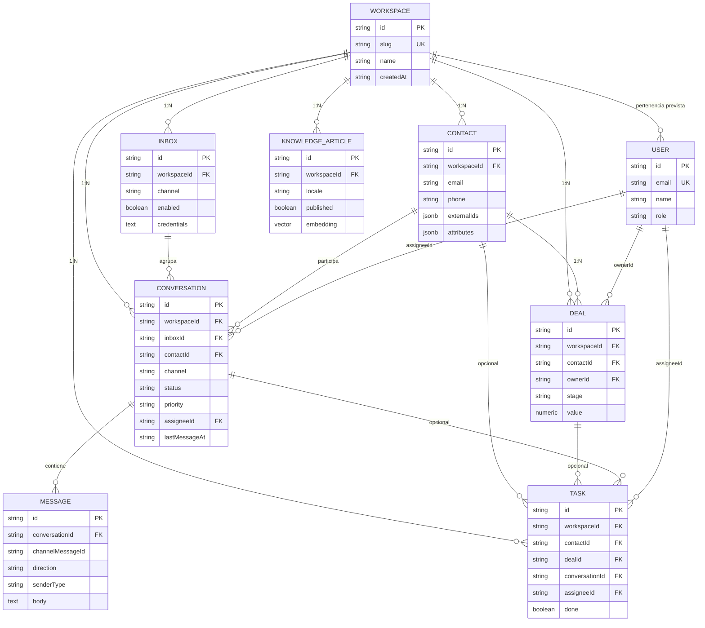

# Modelo de datos de Conversa CRM

> Este documento describe los contratos **reales** de `src/lib/types.ts` y propone
> el esquema de persistencia **previsto**. Donde no hay implementación se indica
> explícitamente "previsto" o "recomendado".

## 1. Convenciones

- Todas las fechas son cadenas ISO 8601 (`createdAt`, `updatedAt`, `dueAt`,
  `lastMessageAt`, `timestamp`).
- Los identificadores son `string`; se recomienda `uuid` en Postgres y `crypto.randomUUID()`
  en la capa de aplicación (generación prevista).
- `workspaceId` es el prefijo de aislamiento (tenant) en casi todas las entidades.
- `metadata` / `attributes` / `externalIds` son mapas; en Postgres se recomienda
  `jsonb`.
- Las entidades y sus campos descritos en la sección 2 **ya existen** en
  `src/lib/types.ts`. Las tablas, índices y restricciones de las secciones 4-6 son
  propuestas **previstas**.

## 2. Entidades existentes en `src/lib/types.ts`

### 2.1 `Workspace`

| Campo | Tipo | Notas |
| --- | --- | --- |
| `id` | `string` | Identificador del espacio de trabajo |
| `name` | `string` | Nombre visible |
| `slug` | `string` | Identificador amigable / subdominio (previsto) |
| `createdAt` | `string` | ISO 8601 |

### 2.2 `User`

| Campo | Tipo | Notas |
| --- | --- | --- |
| `id` | `string` | Identificador |
| `name` | `string` | Nombre visible |
| `email` | `string` | Correo; candidato a único |
| `role` | `Role` | `owner` \| `admin` \| `agent` \| `viewer` |
| `avatarUrl?` | `string` | Opcional |

> El tipo **no** contiene `workspaceId`. La pertenencia usuario ↔ workspace se
> modelará en una tabla de unión separada (prevista, sección 3).

### 2.3 `Contact`

| Campo | Tipo | Notas |
| --- | --- | --- |
| `id` | `string` | Identificador |
| `workspaceId` | `string` | Tenant |
| `name` | `string` | Nombre |
| `email?` | `string` | Opcional |
| `phone?` | `string` | Opcional |
| `externalIds` | `Record<string, string>` | IDs por canal, p. ej. `{ telegram: "12345" }` |
| `attributes` | `Record<string, string \| number \| boolean \| null>` | Atributos CRM personalizados |
| `createdAt`, `updatedAt` | `string` | ISO 8601 |

### 2.4 `Inbox`

| Campo | Tipo | Notas |
| --- | --- | --- |
| `id` | `string` | Identificador |
| `workspaceId` | `string` | Tenant |
| `name` | `string` | Nombre visible |
| `channel` | `ChannelType` | Canal asociado |
| `enabled` | `boolean` | Activo / desactivado |
| `credentials` | `Record<string, string>` | **Cifradas en reposo**; nunca se envían desencriptadas al cliente |
| `createdAt`, `updatedAt` | `string` | ISO 8601 |

### 2.5 `Conversation`

| Campo | Tipo | Notas |
| --- | --- | --- |
| `id` | `string` | Identificador |
| `workspaceId` | `string` | Tenant |
| `inboxId` | `string` | `Inbox` de origen |
| `channel` | `ChannelType` | Canal de origen |
| `contactId` | `string` | `Contact` participante |
| `subject?` | `string` | Asunto (email) o resumen |
| `status` | `ConversationStatus` | `open` \| `pending` \| `resolved` \| `snoozed` |
| `priority` | `Priority` | `low` \| `normal` \| `high` \| `urgent` |
| `assigneeId?` | `string` | `User` asignado |
| `labels` | `string[]` | Etiquetas |
| `unread` | `boolean` | Bandera de no leído |
| `lastMessageAt` | `string` | Ordenación de la bandeja |
| `createdAt`, `updatedAt` | `string` | ISO 8601 |
| `metadata?` | `Record<string, unknown>` | Datos extra |

### 2.6 `Message`

| Campo | Tipo | Notas |
| --- | --- | --- |
| `id` | `string` | Identificador |
| `conversationId` | `string` | `Conversation` contenedora |
| `direction` | `"inbound" \| "outbound"` | Sentido |
| `senderType` | `"contact" \| "agent" \| "bot" \| "system"` | Origen |
| `authorName?` | `string` | Nombre del autor |
| `body` | `string` | Contenido de texto |
| `attachments?` | `Attachment[]` | `{ name, url, mime?, size? }` |
| `channelMessageId?` | `string` | **ID del proveedor para idempotencia** |
| `createdAt` | `string` | ISO 8601 |
| `metadata?` | `Record<string, unknown>` | Datos extra |

### 2.7 `KnowledgeArticle`

| Campo | Tipo | Notas |
| --- | --- | --- |
| `id`, `workspaceId` | `string` | Identificador y tenant |
| `title`, `content` | `string` | Contenido |
| `locale` | `string` | Idioma |
| `published`, `showInSearch` | `boolean` | Publicación y exposición en búsqueda |
| `embedding?` | `number[]` | Vector para RAG (pgvector, previsto) |
| `createdAt`, `updatedAt` | `string` | ISO 8601 |

### 2.8 `Deal`

| Campo | Tipo | Notas |
| --- | --- | --- |
| `id`, `workspaceId` | `string` | Identificador y tenant |
| `contactId` | `string` | `Contact` asociado |
| `title` | `string` | Título |
| `value` | `number` | Importe |
| `currency` | `string` | Moneda |
| `stage` | `string` | Etapa del embudo |
| `ownerId?` | `string` | `User` responsable |
| `createdAt`, `updatedAt` | `string` | ISO 8601 |

### 2.9 `Task`

| Campo | Tipo | Notas |
| --- | --- | --- |
| `id`, `workspaceId` | `string` | Identificador y tenant |
| `title` | `string` | Título |
| `done` | `boolean` | Estado |
| `dueAt?` | `string` | Vencimiento ISO 8601 |
| `assigneeId?` | `string` | `User` asignado |
| `contactId?`, `dealId?`, `conversationId?` | `string` | Enlaces opcionales a `Contact`, `Deal` y `Conversation` |
| `createdAt` | `string` | ISO 8601 |

### 2.10 Tipos de soporte

- `Attachment`: `name`, `url`, `mime?`, `size?`.
- `CredentialField`: `key`, `label`, `type`
  (`text` \| `password` \| `url` \| `select` \| `textarea`), `placeholder?`,
  `help?`, `required?`, `options?`.
- `ChannelDefinition`: descripción declarativa de un canal — `type`, `name`,
  `description`, `docsUrl?`, `fields`, `inbound`, `outbound`.
- `InboundMessage`: evento normalizado de entrada — `channel`, `inboxId?`,
  `externalMessageId`, `externalContactId`, `contactName?`, `contactEmail?`,
  `contactPhone?`, `body`, `attachments?`, `timestamp?`, `subject?`, `raw?`.
- `OutboundResult`: `externalMessageId?`, `delivered`, `error?`.
- `Store`: interfaz de persistencia con `list*`, `get*`, `upsert*` y
  `addMessage`; implementaciones previstas: JSON local y Postgres.

## 3. Relaciones

Reglas de integridad recomendadas (previstas):

- Toda consulta debe estar filtrada por `workspaceId` (aislamiento de tenant).
- `Conversation.contactId`, `Conversation.inboxId` y `Message.conversationId` son
  obligatorios en la práctica; se recomienda `ON DELETE RESTRICT` para no perder
  historial.
- `assigneeId`, `ownerId` y los enlaces de `Task` son opcionales y pueden quedar
  nulos si el usuario/contacto se elimina (`ON DELETE SET NULL`).
- `Role` y los enumerados del tipo se validarán con `zod` en la capa API (previsto).

### Pertenencia de usuarios (prevista)

Como `User` no tiene `workspaceId`, se prevé una tabla de unión
`workspace_users(workspaceId, userId, role, joinedAt)` con clave primaria
compuesta. El `role` de `User` se mantiene como rol global por ahora; la
autorización por workspace se añadirá en la fase de equipo.

### Identidades externas de contacto (prevista)

`Contact.externalIds` es un mapa en el tipo. Para buscar y deduplicar por canal
se recomienda una tabla normalizada
`contact_external_ids(workspaceId, channel, externalId, contactId)` con única
`(workspaceId, channel, externalId)`, sin eliminar el campo del tipo.

## 4. Índices recomendados (previstos)

| Tabla | Índice | Motivo |
| --- | --- | --- |
| `workspaces` | `UNIQUE (slug)` | Resolución de workspace por URL |
| `users` | `UNIQUE (email)` | Identificación de usuario / login (previsto) |
| `workspace_users` | `PK (workspaceId, userId)`, `INDEX (userId)` | Pertenencia y autorización |
| `contacts` | `UNIQUE (workspaceId, email)` (parcial, `email IS NOT NULL`) | Deduplicación por correo |
| `contacts` | `INDEX (workspaceId, phone)` (parcial) | Deduplicación por teléfono |
| `contacts` | `GIN (attributes jsonb_path_ops)`, `GIN (externalIds jsonb_path_ops)` | Búsqueda por atributos / IDs externos |
| `contact_external_ids` | `UNIQUE (workspaceId, channel, externalId)` | Resolución rápida de contacto por canal |
| `inboxes` | `UNIQUE (workspaceId, channel)` | Una configuración activa por canal |
| `conversations` | `INDEX (workspaceId, lastMessageAt DESC)` | Ordenar la bandeja |
| `conversations` | `INDEX (workspaceId, status, lastMessageAt DESC)` | Filtros de estado |
| `conversations` | `INDEX (inboxId, status)`, `INDEX (contactId)`, `INDEX (assigneeId)` | Filtrado por canal, contacto y agente |
| `conversations` | `INDEX (workspaceId) WHERE unread = true` | Contadores de no leídos |
| `messages` | `INDEX (conversationId, createdAt)` | Historial paginado de una conversación |
| `messages` | `UNIQUE (channel, channelMessageId) WHERE channelMessageId IS NOT NULL` | Idempotencia de webhooks |
| `knowledge_articles` | `INDEX (workspaceId, published, locale)` | Búsqueda de base de conocimiento |
| `knowledge_articles` | `INDEX USING hnsw (embedding vector_cosine_ops)` (o `ivfflat`) | RAG con pgvector (previsto) |
| `deals` | `INDEX (workspaceId, stage)`, `INDEX (contactId)`, `INDEX (ownerId)` | Pipeline y responsables |
| `tasks` | `INDEX (workspaceId, done, dueAt)`, `INDEX (assigneeId)`, `INDEX (conversationId)` | Tareas pendientes y vencimientos |

Nota sobre `messages`: la interfaz `Store` expone hoy
`getMessageByExternalId(channelMessageId)` con un único parámetro. Para aplicar
la única compuesta recomendada, la implementación Postgres (prevista) deberá
derivar el `channel` desde la conversación relacionada o ampliar la firma del
método. Es una decisión pendiente, no un cambio a realizar en `types.ts` sin
acuerdo del equipo.

## 5. Reglas de idempotencia por `channelMessageId`

`Message.channelMessageId` es el ID del proveedor (origen:
`InboundMessage.externalMessageId`; en mensajes salientes,
`OutboundResult.externalMessageId`). Los proveedores reintentan webhooks y pueden
entregar el mismo evento más de una vez, por lo que el flujo debe ser seguro ante
repetición:

1. **Verificar antes de escribir.** Al normalizar el payload, llamar a
   `Store.getMessageByExternalId(channelMessageId)` (previsto). Si existe,
   responder `200 OK` sin insertar ni actualizar contadores.
2. **Restricción de base de datos.** La defensa definitiva es la restricción
   única `(channel, channelMessageId)` de la sección 4; un `INSERT ... ON CONFLICT
   DO NOTHING` evita duplicados incluso bajo concurrencia entre invocaciones
   serverless (previsto).
3. **Orden transaccional recomendado** para un mensaje nuevo (previsto):
   `upsert Contact` (por `externalIds`) → `upsert Conversation` (por
   `workspaceId + inboxId + contactId`) → `addMessage` con
   `direction = "inbound"` → actualizar `Conversation.lastMessageAt` y `unread`.
4. **Concurrencia.** Dos webhooks del mismo mensaje pueden ejecutarse a la vez;
   no depender solo de la lectura previa. Ante violación de la restricción única,
   tratar la operación como éxito (idempotente).
5. **Mensajes salientes.** Guardar el `externalMessageId` devuelto por el
   proveedor en `channelMessageId` para correlacionar confirmaciones, rebotes y
   reintentos de entrega.
6. **Mensajes del widget.** El cliente debe generar un `externalMessageId`
   estable (UUID) y reutilizarlo en reintentos; el servidor lo mapea a
   `channelMessageId`.
7. **Sin ID externo.** Si un proveedor no entrega identificador, se recomienda
   derivar uno determinista (hash de `channel + externalContactId + timestamp +
   body`) para no perder idempotencia (previsto).
8. **Auditoría.** `InboundMessage.raw` permite inspeccionar el payload original
   durante depuración; no debe persistirse de forma indefinida sin política de
   retención (previsto).

## 6. Cifrado de credenciales de canales en reposo

El campo `Inbox.credentials` contiene secretos (tokens de acceso, tokens de
verificación, secretos de app) y el contrato indica que **nunca se envían al
cliente sin desencriptar en servidor** (de hecho, nunca deben enviarse al cliente
en texto plano).

Estado actual: la variable `CREDENTIALS_ENCRYPTION_KEY` existe en `.env.example`
y el campo existe en el tipo. La implementación del cifrado es **prevista**.
Esquema recomendado:

1. **Clave.** `CREDENTIALS_ENCRYPTION_KEY` con 32 bytes en hexadecimal, generada
   con `node -e "console.log(require('crypto').randomBytes(32).toString('hex'))"`.
   Se carga solo en el entorno del servidor; jamás se expone con prefijo
   `NEXT_PUBLIC_`.
2. **Algoritmo.** AES-256-GCM (autenticado) con un vector de inicialización
   aleatorio de 12 bytes por valor cifrado, usando `crypto` de Node.
3. **Formato de almacenamiento.** Cadena autosuficiente con versión,
   p. ej. `v1:<iv_b64>:<tag_b64>:<ciphertext_b64>`, de modo que se pueda rotar
   claves en el futuro (`v2:...`) sin migración destructiva (rotación prevista).
4. **Ámbito.** Se cifra cada valor del mapa `credentials`; las claves del mapa
   (p. ej. `accessToken`) pueden permanecer en claro para que la UI sepa qué
   campos pedir, valorando el `CredentialField.type === "password"`.
5. **Uso.** El adaptador de canal desencripta en memoria, construye el cliente
   del proveedor y descarta el secreto; nunca se incluye en respuestas HTTP,
   logs ni mensajes de error.
6. **Alternativa en despliegue.** Los secretos también pueden declararse como
   variables de entorno (ver `.env.example`: `WHATSAPP_*`, `TELEGRAM_BOT_TOKEN`,
   `INSTAGRAM_*`, `FACEBOOK_PAGE_ACCESS_TOKEN`, `EMAIL_*`, `TWILIO_*`,
   `WIDGET_IDENTITY_SECRET`), configuradas en Vercel. La UI sobrescribe o
   complementa esos valores con credenciales cifradas en base de datos (previsto).
7. **Precauciones.** No registrar secretos en logs de Vercel; no guardar
   `.env.local` en el repositorio; usar claves distintas por entorno
   (desarrollo, preview, producción); al rotar la clave, reprocesar las filas
   `Inbox` (procedimiento previsto).

## 7. Notas de migración (previstas)

- `DATABASE_URL` vacía → implementación `Store` JSON local (`.data/`), solo
  desarrollo.
- `DATABASE_URL` presente → implementación `Store` Postgres; requiere esquema y
  migraciones (previstas) antes del primer despliegue.
- La carga de `embedding` y la extensión `pgvector` deben habilitarse en el
  proveedor de base de datos antes de activar RAG.
- Ninguna de estas implementaciones existe hoy: `src/lib/db` es un directorio
  previsto.
